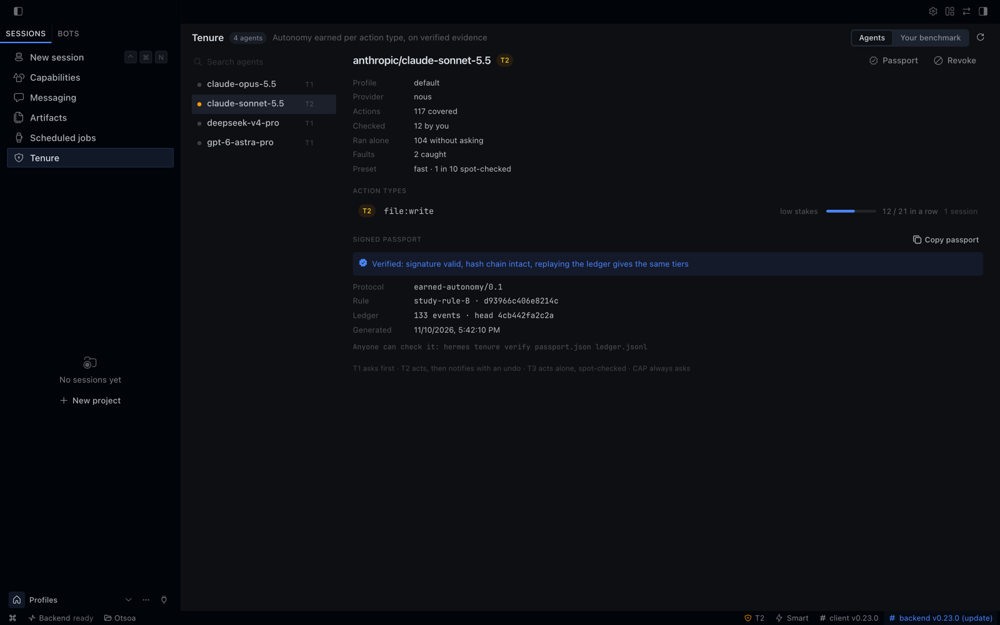

<h1 align="center">tenure</h1>

<p align="center"><strong>Autonomy your agent earns, one action type at a time, on evidence you can check.</strong></p>

<p align="center">
  A plugin for <a href="https://github.com/NousResearch/hermes-agent">Hermes Agent</a>. Every change your agent makes asks first.
  Each kind of action earns the right to act alone, under a risk you set, and loses it on one fault.
</p>

<p align="center">
  
  
  
  
  <a href="https://osf.io/vycge/"></a>
</p>

<p align="center">
  <a href="#install-in-60-seconds">Install</a> ·
  <a href="#how-it-works">How it works</a> ·
  <a href="#the-study-behind-the-rule">The study</a> ·
  <a href="#the-guarantee">The guarantee</a> ·
  <a href="#self-protection">Self-protection</a> ·
  <a href="#commands">Commands</a>
</p>

<p align="center"></p>

## The problem

Out of the box, Hermes asks about a short list of risky-looking commands and lets everything else through, and
there is no way to say "trust it on this, not on that". You either babysit every step or hand over the keys.

tenure closes that gap. Every action that changes something asks first, through Hermes' own approval prompt.
Each action type (writing files in the project, `npm`, `git push`, sending a message, one MCP tool) keeps its own
verified record and climbs three tiers, only on evidence:

| Tier | What happens |
|---|---|
| **Ask** | Every action of the type asks you first. Everything starts here. |
| **Act, then notify** | The agent acts, then tells you, with an undo: the files it touched were saved first (24 hours, 5 MB per action). Only for reversible types at low or medium stakes. |
| **Act alone** | The agent acts alone. A random share of actions (one in ten by default) still asks, as a spot check. |

One fault and the type drops back. Ordinary reads never ask; secrets, sensitive files, the agent's own skills and
plugins, and anything that could switch tenure off always do (see [Self-protection](#self-protection)).

| | Hermes by default | `--yolo` | An allowlist | **tenure** |
|---|---|---|---|---|
| Asks before a change | a short list of commands | never | until you allow it | every change, at first |
| Trust per kind of action | no | no | by hand | **earned, per action type** |
| Trust taken back | no | no | by hand | **on one fault** |
| A risk you choose, with its numbers | no | no | no | **yes, per stakes level** |
| Evidence someone else can check | no | no | no | **signed passport** |

## Three pillars

**1. Your own benchmark.** Public leaderboards say how a model does on someone else's tasks. tenure keeps a
table of how each model does on yours: verified successes and faults per action type, always with the
denominator (`3 faults / 140 checks`). A bundled snapshot of public scores sits beside it, and a model that
scores clearly lower on the same benchmark loses a carry-over. A model with no public measure is shown as such.


**2. The live map.** The dashboard tab shows every agent and every action type: its tier, its evidence, what it
still needs, and what changes if you switch model or move the risk dial. Each change comes with its reason.


**3. The autonomy passport.** One file that states what an agent earned and on what evidence. It is signed and
tamper-evident: anyone holding the passport and the exported ledger can replay the ledger and recompute the
same tiers (`hermes tenure verify`). The format is in [docs/protocol.md](docs/protocol.md).


**Native in Hermes Desktop too.** The package also ships a desktop half: a **Tenure** page in the sidebar (map,
models, passport), a status-bar chip with the tiers of the model in use, and ⌘K commands to open the map, show the
current model's passport or revoke it. Like every desktop half, it is opt-in: enable it once in
**Capabilities → Plugins**.




## Install in 60 seconds

```bash
hermes plugins install otsoa-dubief/tenure/tenure
hermes gateway restart          # if a gateway is running
hermes tenure setup          # the three presets side by side
```

Requires Hermes 0.23.0 or later and Python 3.11 or later. No network, no LLM call, nothing to configure to start.
Work as usual: `hermes tenure` shows where each action type stands.

## The study behind the rule

tenure uses the same rule as a preregistered study, replayed on 6,000+ simulated agents (results pending; see [docs/the-study.md](docs/the-study.md)).

> **The question.** When can an AI agent be trusted to act alone, one action type at a time, on verified evidence,
> under an error budget fixed in advance, with a guarantee anyone can check and revoke?

| | |
|---|---|
| **Preregistered** | Plan, rule, replay engine and decision criteria frozen at a git tag and [registered on OSF](https://osf.io/vycge/) on 10 November 2026, before any confirmatory data. Embargoed until the results are out. |
| **Falsifiable** | What would refute the rule is written down in advance. The result will be published whatever it is, negative included. |
| **Validated first** | The rule was replayed on 6,000+ simulated agents (519 synthetic worlds × 12 model-environment configurations), where the truth is known, to check that the decision procedure reaches the right verdict. |
| **Running now** | Three Claude models play four environments of two public agent benchmarks (τ-bench 2.0 airline, retail and banking; WorkBench): 14,266 planned episodes. Every write with a known tool is judged by exact comparison with the task's expected actions; automated alerts are reviewed on blind sheets, and a human re-reviews a random draw without seeing the first verdict. |
| **Compared against** | Fixed allowlists and risk-based triage, replayed offline on the same episodes. |

**What tenure claims, and what it does not.** It runs the study's rule, with the layers below. It does not
claim that the study has confirmed the rule: the results are pending, and this section will say what they are.

### What tenure adds or adapts

The middle tier (act, then notify) is part of the study.

Added layers:

- spot checks on a cleared type (one in ten by default);
- the requirement of two distinct sessions;
- suspension after external content.

Adaptations:

- human approval plus clean execution counts as proof, an adaptation of the study's automatic control;
- one trial covers the faults that happen during the wait and the inherited faults;
- evidence is re-based when the stakes of a type change;
- a trial is the next 3 real actions, asked; the study replays 3 hidden variants of the faulty case.

Carry-over is our addition; strict mode is the study. The public-benchmark veto is our addition too.

## How it works

**Agents.** Each action type of each agent (`model@provider`) is in one of the three tiers above.

**Proofs.** A type climbs on verified outcomes, judged after the tool has run: an approved action that ran
cleanly and whose automatic check passed (the written file still parses, the exit code is zero) is a success, and
so is an act-then-notify action whose check passed (you can still undo it: an undo is a fault). A refusal, an
undo or an error you flag is a fault, and a failed check is a fault at any tier. What nobody verified (timeout,
failed tool, no one answering, a clean action taken alone) counts for nothing. A fault resets the series. A
low-stakes fault at act-alone drops one tier (to act-then-notify if the type is reversible). A medium or high
fault sends the type back to asking, lengthens the next climb, and opens a trial of 3 verified successes.
Asked-but-never-run actions are never counted as successes.

**Two sessions.** The series that reaches "act alone" must hold successes from at least two distinct sessions.

**Suspension after external content.** A session asks for everything, until it ends, after using one of these
tools or commands: web search and extraction, the browser, `read_file` outside the project, `execute_code`,
downloads and network commands in the terminal (`curl`, `wget`, `git clone`, `git pull`, `git fetch`, `gh` reads...),
and the read tools of MCP servers that bring in outside content (mail, chat, web, search, GitHub, Notion...). The
exact list, and what is not detected, is in [docs/self-protection.md](docs/self-protection.md#suspension-after-external-content).

**Model change.** A new model inherits half its evidence provisionally (confirmed by its own
successes), except at high stakes or when it scores more than 5 points lower on the matching public benchmark. Strict mode (`hermes tenure strict on`) starts every type
over instead. A returning model keeps its own record.

## The guarantee

You pick the risk you accept per stakes level. tenure picks the smallest number of approvals in a row that keeps
the share of unapproved errors under it (Dodge's continuous sampling plan CSP-1, with one spot check in ten). The
table is generated from the same code that decides (`params.describe`), and a test checks it.

Cell: approvals in a row, guarantee (errors that run unapproved, as a share of all actions of the type, for a
stable agent), worst case (for an agent that turns bad after tenure, until a caught error revokes it).

| Preset | Low stakes (files in the project, memory) | Medium (commands, code, files elsewhere) | High (leaves the machine, money) |
|---|---|---|---|
| careful | 105 approvals · 1.0% · worst 7.8% | 210 approvals · 0.5% · worst 4.1% | 1052 approvals · 0.1% · worst 0.8% |
| **balanced** (default) | 52 approvals · 2.1% · worst 14.5% | 105 approvals · 1.0% · worst 7.8% | always asks |
| fast | 21 approvals · 5.0% · worst 29.0% | 52 approvals · 2.1% · worst 14.5% | always asks |

Errors you catch never run: a refused action is blocked. `hermes tenure explain` prints the numbers for your own
settings.

## Self-protection

An agent that can switch off its own supervision is not supervised. Whatever its tier, these always ask, and no
type override lowers them (`self:*`, `secrets:*`, `file:sensitive`):

- **Hermes and tenure themselves.** Hermes' CLI (except a few reads, such as `hermes status`), every file and
  folder Hermes reads from its home and that changes what it does, the Hermes program and its installed package,
  and tenure's own data. The check is made on the path once normalised and resolved (links, `..`, globs,
  braces, a glued option value), whatever program, tool or piece of code names it, and Hermes' CLI is recognised
  behind any launcher.
- **Code that would run later without asking.** Shell start-up files, git hooks and git configuration that runs a
  program, `PATH` and loader variables, editor and pager settings outside an allow list, `~/.local/bin`, login
  agents. Recognised command by command, best effort.

What can still get through is written down, family by family: a path that only exists once the code runs, a tree
walk that follows links, your own home folder as a whole, and a few others. This is a strong check on honest
mistakes and on plain attempts, not a wall against an agent that hides what it does: **if the agent is not
trusted, run Hermes in a container**, with only the project mounted, and keep code-running types at `cap`.

The full rules, every protected entry and every known gap: [docs/self-protection.md](docs/self-protection.md).

## Commands

| Command | What it does |
|---|---|
| `hermes tenure` · `hermes tenure status [--profile P] [--model M] [--all]` · `/tenure` | What each agent has earned, per action type |
| `hermes tenure setup [careful\|balanced\|fast]` | The presets side by side; with a name, use it |
| `hermes tenure explain` | How it decides, and the guarantee for your settings |
| `hermes tenure models [--type T]` | Each model's verified record on your own work |
| `hermes tenure undo [ID]` | Restore the files of an act-then-notify action; without an ID, list what can still be undone |
| `hermes tenure flag TYPE [note]` | Report an error the agent made on its own: revokes that type |
| `hermes tenure revoke TYPE\|all [--model M\|--all]` | Take earned autonomy back: one type or every type, for the last active agent, one model, or every agent |
| `hermes tenure passport [--agent A] [--out FILE] [--no-redact]` | Write the signed passport of an agent |
| `hermes tenure verify PASSPORT [LEDGER] [--key HEX]` | Check a passport, against the exported ledger when given; `--key` pins the owner's public key |
| `hermes tenure anchor` | One line to publish: the ledger's head, date and length |
| `hermes tenure export [PATH]` | Write the evidence ledger as hash-chained JSON lines |
| `hermes tenure strict on\|off` | Strict mode: a new model starts with an empty record |
| `hermes tenure cleanup` | List dead tenure keys in Hermes' permanent allowlist (prints, never edits) |

Settings, in `config.yaml` under `plugins.entries.tenure.settings`:

```yaml
preset: balanced            # careful | balanced | fast
risks: {low: 1/50, medium: 1%, high: cap}   # your own, over the preset
spot_check: 0.1             # share of a cleared type's actions that still ask
strict: false
types: {"mcp:notion:*": medium, "shell:git:push": cap}   # reclassify action types
enabled: true
```

## Limits

- **It over-asks by design.** Shell constructs outside the supported grammar (`if`, `for`, functions, globs in a
  write target), write targets it cannot resolve, and any name that looks sensitive are classified as high stakes
  or always-ask. Most wrong guesses cost you a question.
- **Static reading, not a sandbox.** tenure classifies the text of a command before it runs. A spelling it does
  not recognise can slip through: a tool's own setting variable it does not watch (`GH_PAGER`,
  `RIPGREP_CONFIG_PATH`, `KUBECONFIG`...), a shell alias, function or `trap` set in an earlier call, or a form of a
  command nobody has thought of yet. Each one found so far is capped in the tests (`tests/test_audit_cap_bypass.py`).
  If the agent itself is untrusted, run Hermes in a container as well.
- **Granularity is per action type.** A cleared `shell:python` can run any Python. Reclassify broad types as `cap`
  if that matters to you.
- **Memory is low stakes.** Hermes' `memory` tool is classed with project files (low stakes), so it can be cleared;
  writing the files under `memories/` directly is capped. Reclassify `memory:write` if memories steer your agent.
- **The passport is tamper-evident; it cannot prevent tampering.** It is signed by the owner's own key, so the owner can
  rewrite a whole history and re-sign it. Anchor its head (`hermes tenure anchor`) somewhere public to fix a point in time.
  The signature shows that a passport matches a ledger, not who made it: pin the owner's key with `verify --key`.
  An older passport still verifies against a longer ledger; `verify` then says what changed since.
- **The database trusts itself.** tenure reads its tiers from its own database, and the hash chain is not a
  secret. Code that is already allowed to run (see the limit under Self-protection) could rewrite both; writing
  them by any command tenure can read is capped.
- **Redaction uses unsalted hashes.** A redacted passport hides a type name from a casual reader, not from
  someone who guesses it.
- **SQLite side files.** The dashboard opens each database read-only; on a database in WAL mode SQLite may still
  create or touch the `-wal` and `-shm` files next to it. No table or row is written by a read.
- **Settings from the dashboard** (`/settings`) may not reach the plugin from the dashboard process; the tab then
  shows the CLI command to run.
- **Learning needs a person to answer.** `approvals.mode` `smart` (the Hermes default) and `manual` both work:
  tenure's own approvals skip the smart guardian and always reach you. With `--yolo`, `off` or cron, Hermes
  settles the ask itself and nothing is learned; a verdict given by the smart guardian on Hermes' own prompts
  counts for nothing.
- **Git hooks.** `git config core.hooksPath .husky` (the husky set-up) is capped: it always asks.
  Turning a pager on or off (`pager.log false`) is ordinary.
- Approvals count only when a person answers. Records are per model and per Hermes profile.
- The guarantee covers errors you would refuse when asked. An error nobody would notice cannot be counted.

## Privacy

Stored, in `plugin-data/tenure/tenure.db` of each Hermes profile: action types and stakes, outcomes, tiers,
the agent string `model@provider`, sessions as `sha256(session id)[:12]`, timestamps, and a hash chain over all of
it. 
Never in the database or the ledger: a whole command, a path, file content, a message, or a secret. Type names can
include a script, target or alias name taken from the command (`shell:npm:run:build`, `shell:make:deploy`,
`shell:git:my-alias`): the ledger keeps them, and the passport and the dashboard redact them by default (a hash of
the name, see [docs/protocol.md](docs/protocol.md) §3.1). The undo snapshots (file bytes and their paths, mode
0600) are the one other exception, deleted after 24 h. The database also holds the undo HMAC key, a random
secret that signs each snapshot so that a changed snapshot is never restored. Nothing leaves your machine:
no network access, no LLM call, no telemetry. tenure does not read `.env`, `auth.json` or any credential
store. Reads outside the plugin folder, as the catalog asks: the dashboard tab reads, read-only, the
`plugin-data/tenure/tenure.db` of the Hermes root and of each `profiles/*` folder; act-then-notify reads the
project files an action is about to change, to snapshot them for undo (24 hours, 5 MB per action).

## License

Apache-2.0 · © 2026 Otsoa Dubief. Benchmark data: Epoch AI, CC BY 4.0, see [NOTICE](tenure/NOTICE).
