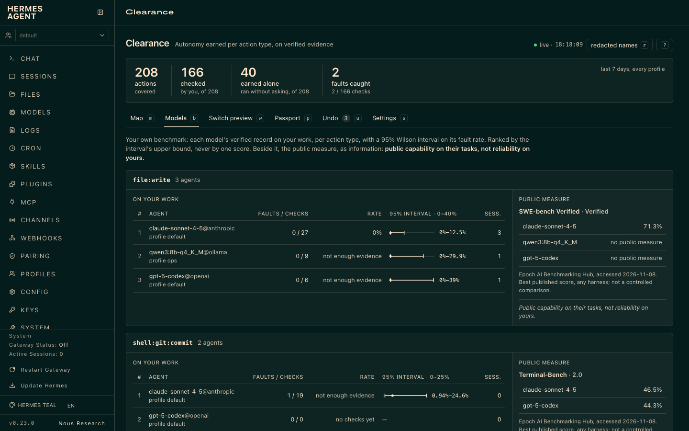
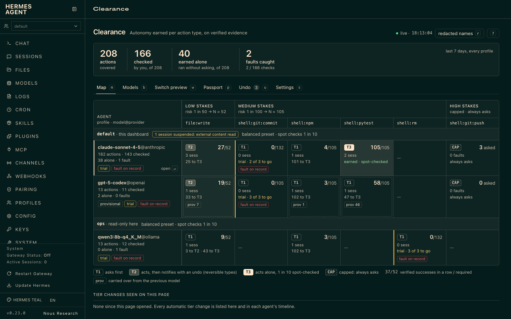
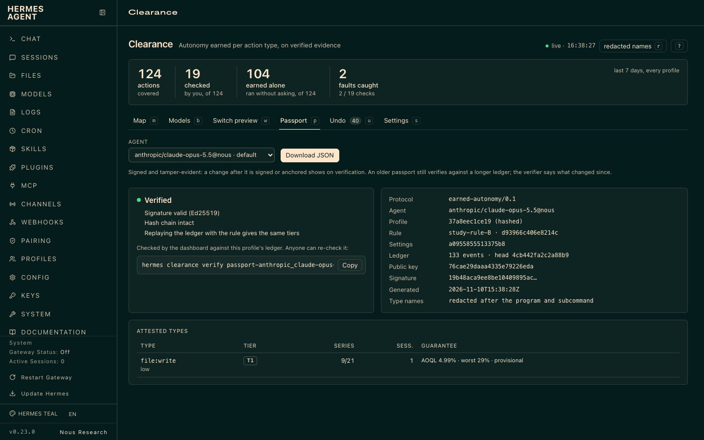
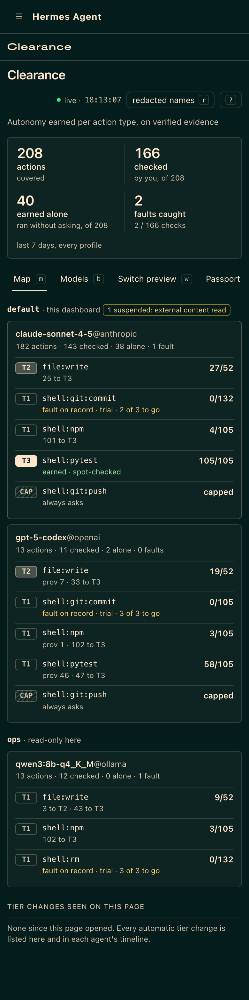

# clearance: everything covered, autonomy earned

**Every change your agent makes is covered; each action type earns the right to act alone, on evidence, under a risk you set.**

Hermes alone asks only for commands that look dangerous. clearance covers every action that changes something,
and your agent earns its way back to acting alone, one action type at a time, with a guarantee you choose.

Out of the box, Hermes asks about a short list of risky-looking commands and lets everything else through,
and there is no way to say "trust it on this, not on that". clearance
closes that gap: every action that changes something asks first, through Hermes' own approval prompt. Each
action type (writing files in the project, `npm`, `git push`, sending a message, one MCP tool) keeps its own
verified record, and climbs three tiers: ask, act then notify (with undo), act alone. It climbs only on
evidence. Ordinary reads never ask; secrets, sensitive files and the agent's own skills and plugins always do.
So does anything that could switch clearance off. No type override lowers these (`self:*`, `secrets:*`,
`file:sensitive`):

- Hermes' own CLI, when the program run is `hermes` (also through `sh -c`, `script -c`, `su -c`, `tmux`, `screen`,
  `expect`, `ssh`, `uvx`, `uv run`, `pipx run`, a git alias, `$(which hermes)`), or Python code that imports or runs
  `hermes_cli` or `hermes_constants`. Only these reads are not capped: `hermes status`, `hermes --version`,
  `hermes config get|show|path|env-path` and `hermes clearance status|models|explain|verify|anchor`.
- Hermes' own entries in each Hermes home (wherever `HERMES_HOME` points, its root, and `~/.hermes`), and the same
  entries in each `profiles/<name>/`: `config.yaml`, `.env`, `auth.json` and `auth.lock`, `SOUL.md`, `profile.yaml`,
  `state.db` and its journal files, and the folders `plugins/`, `plugin-data/`, `skills/`, `optional-skills/`,
  `hooks/`, `cron/`, `memories/`, `sessions/`, `logs/`, `plans/`, `skins/`, `pairing/`, `platforms/`, `bin/`,
  `mcp/`, `secrets/`, `vault/`, `backups/`, `state-snapshots/`, `hermes-agent/`, `.deleted/`, the gateway's
  `gateway.sock`, `gateway.pid` and `gateway.lock`; a whole profile, and removing or moving a home. A project or a
  workspace inside a home (`workspace/`, `kanban/workspaces/...`) is ordinary.
- Anything naming clearance's own data: `clearance.db`, `plugin-data/clearance`, the passport key.
- The fail-safe behind these rules: a command that writes is capped when one of its arguments resolves (through
  symlinks, `$HERMES_HOME`, variables set earlier on the line, options glued to their value, or a glob that may
  match) to a Hermes home level (a home, its root, the `.hermes` folder at the top of a home, a `profiles/<name>`
  folder) or to the Hermes program (a path to `bin/hermes`, a link, hard link or copy of it, its installed package),
  and when it runs inside a home level or an entry. A `cd`, `pushd` or `env -C` into one, or to a target that cannot
  be worked out, is capped even alone, and the terminal's working directory is followed from one call to the next.
  The same holds for paths written in code (`execute_code`, `python -c`). A program that resolves to Hermes under
  another name, looked up on PATH at each call, is Hermes. Workspaces below a home level stay ordinary, and so do a
  `.hermes` folder inside a project and your own home folder when Hermes lives there (Docker); unpacking an archive
  into your home folder asks (high stakes). A path argument the shell computes (a variable, a substitution, a brace
  list, `~user`, the `{}` of find or xargs), a `cd` to such a target, and `tar -P` ask too (high stakes), and are
  capped when their literal part names Hermes. Setting `CDPATH` is capped.
- The limit, stated plainly: this is a static reading of the command, not a proof of what it will do. It is a
  fail-safe floor: what it cannot read with certainty goes up to asking you, and a determined program can still
  hide its target (code that builds a path at run time, a variable set by an earlier command) behind a high-stakes
  ask rather than a cap.

## Three pillars

**1. Your own benchmark.** Public leaderboards say how a model does on someone else's tasks. clearance keeps a
table of how each model does on yours: verified successes and faults per action type, always with the
denominator (`3 faults / 140 checks`). A bundled snapshot of public scores sits beside it, and a model that
scores clearly lower on the same benchmark loses a carry-over. A model with no public measure is shown as such.



**2. The live map.** The dashboard tab shows every agent and every action type: its tier, its evidence, what it
still needs, and what changes if you switch model or move the risk dial. Each change comes with its reason.



**3. The autonomy passport.** One file that states what an agent earned and on what evidence. It is signed and
tamper-evident: anyone holding the passport and the exported ledger can replay the ledger and recompute the
same tiers (`hermes clearance verify`). The format is in [docs/protocol.md](docs/protocol.md).





## Install in 60 seconds

```bash
hermes plugins install otsoa-dubief/clearance/clearance
hermes gateway restart          # if a gateway is running
hermes clearance setup          # the three presets side by side
```

Requires Hermes 0.23.0 or later and Python 3.11 or later. No network, no LLM call, nothing to configure to start.
Work as usual: `hermes clearance` shows where each action type stands.

## How it works

**Tiers.** Each action type of each agent (`model@provider`) is in one of three tiers.

| Tier | What happens |
|---|---|
| Ask | Every action of the type asks you first. Everything starts here. |
| Act, then notify | The agent acts, then tells you, with an undo: the files it touched were saved first (24 hours, 5 MB per action). Only for reversible types at low or medium stakes. |
| Act alone | The agent acts alone. A random share of actions (one in ten by default) still asks, as a spot check. |

**Proofs.** A type climbs on verified outcomes, judged after the tool has run: an approved action that ran
cleanly and whose automatic check passed (the written file still parses, the exit code is zero) is a success, and
so is an act-then-notify action whose check passed (you can still undo it: an undo is a fault). A refusal, an
undo or an error you flag is a fault, and a failed check is a fault at any tier. What nobody verified (timeout,
failed tool, no one answering, a clean action taken alone) counts for nothing. A fault resets the series. A
low-stakes fault at act-alone drops one tier (to act-then-notify if the type is reversible). A medium or high
fault sends the type back to asking, lengthens the next climb, and opens a trial of 3 verified successes.
Asked-but-never-run actions are never counted as successes.

**Two sessions.** The series that reaches "act alone" must hold successes from at least two distinct sessions.

**Suspension after external content.** A session asks for everything, until it ends, after using one of these
tools or commands:

- the tools `web_search`, `web_extract`, every `browser_*` tool, `read_file` on a path outside the project, and
  `execute_code`;
- in `terminal`: `curl`, `wget`, `http`, `https` and `xh` (HTTPie and xh), `xhs`, `lynx`, `w3m`, `links`, `aria2c`,
  `nc`, `ncat`, `git clone`, `git pull` and `git fetch`, `gh issue view`, `gh pr view` and `gh api` reads (also
  inside `$(...)`, `bash -c`, `xargs`);
- the MCP read tools (a read verb such as get, list, search, read, fetch, and no write verb) of a server whose name
  contains one of: mail, gmail, outlook, imap, slack, discord, telegram, whatsapp, web, fetch, browser, rss, reddit,
  twitter, x, brave, search, exa, tavily, serp, playwright, puppeteer, firecrawl, crawl, scrape, github, gitlab,
  notion, linear, jira, confluence, asana, trello, drive, docs.

Anything else is not detected: a script that downloads by itself (`python fetch.py`, `node fetch.js`), `cat` of a
file outside the project, or an MCP server under another name. A child agent started from a suspended session
starts suspended, and a child agent that read external content suspends its parent.

**Model change.** A new model inherits half its evidence provisionally (confirmed by its own
successes), except at high stakes or when it scores more than 5 points lower on the matching public benchmark. Strict mode (`hermes clearance strict on`) starts every type
over instead. A returning model keeps its own record.

## The guarantee

You pick the risk you accept per stakes level. clearance picks the smallest number of approvals in a row that keeps
the share of unapproved errors under it (Dodge's continuous sampling plan CSP-1, with one spot check in ten). The
table is generated from the same code that decides (`params.describe`), and a test checks it.

Cell: approvals in a row, guarantee (errors that run unapproved, as a share of all actions of the type, for a
stable agent), worst case (for an agent that turns bad after clearance, until a caught error revokes it).

| Preset | Low stakes (files in the project, memory) | Medium (commands, code, files elsewhere) | High (leaves the machine, money) |
|---|---|---|---|
| careful | 105 approvals · 1.0% · worst 7.8% | 210 approvals · 0.5% · worst 4.1% | 1052 approvals · 0.1% · worst 0.8% |
| **balanced** (default) | 52 approvals · 2.1% · worst 14.5% | 105 approvals · 1.0% · worst 7.8% | always asks |
| fast | 21 approvals · 5.0% · worst 29.0% | 52 approvals · 2.1% · worst 14.5% | always asks |

Errors you catch never run: a refused action is blocked. `hermes clearance explain` prints the numbers for your own
settings.

## The study behind the rule

clearance uses the same rule as a preregistered study, simulated on 6,000+ agents (publication pending; see [docs/the-study.md](docs/the-study.md)).

### What clearance adds or adapts

The middle tier (act, then notify) is part of the study.

Added layers:

- spot checks on a cleared type (one in ten by default);
- the requirement of two distinct sessions;
- suspension after external content.

Adaptations:

- human approval plus clean execution counts as proof, an adaptation of the study's automatic control;
- one trial covers the faults that happen during the wait and the inherited faults;
- evidence is re-based when the stakes of a type change;
- a trial is the next 3 real actions, asked; the study replays 3 hidden variants of the faulty case.

Carry-over is our addition; strict mode is the study. The public-benchmark veto is our addition too.

## Commands

| Command | What it does |
|---|---|
| `hermes clearance` · `hermes clearance status [--profile P] [--model M] [--all]` · `/clearance` | What each agent has earned, per action type |
| `hermes clearance setup [careful\|balanced\|fast]` | The presets side by side; with a name, use it |
| `hermes clearance explain` | How it decides, and the guarantee for your settings |
| `hermes clearance models [--type T]` | Each model's verified record on your own work |
| `hermes clearance undo ID` | Restore the files of an act-then-notify action |
| `hermes clearance flag TYPE [note]` | Report an error the agent made on its own: revokes that type |
| `hermes clearance revoke TYPE\|all [--model M\|--all]` | Take a clearance back: one type or every type, for the last active agent, one model, or every agent |
| `hermes clearance passport [--agent A] [--out FILE] [--no-redact]` | Write the signed passport of an agent |
| `hermes clearance verify PASSPORT [LEDGER]` | Check a passport, against the exported ledger when given |
| `hermes clearance anchor` | One line to publish: the ledger's head, date and length |
| `hermes clearance export [PATH]` | Write the evidence ledger as hash-chained JSON lines |
| `hermes clearance strict on\|off` | Strict mode: a new model starts with an empty record |
| `hermes clearance cleanup` | List dead clearance keys in Hermes' permanent allowlist (prints, never edits) |

Settings, in `config.yaml` under `plugins.entries.clearance.settings`:

```yaml
preset: balanced            # careful | balanced | fast
risks: {low: 1/50, medium: 1%, high: cap}   # your own, over the preset
spot_check: 0.1             # share of a cleared type's actions that still ask
strict: false
types: {"mcp:notion:*": medium, "shell:git:push": cap}   # reclassify action types
enabled: true
```

## Limits

- **It over-asks by design.** Shell constructs outside the supported grammar (`if`, `for`, functions, globs in a
  write target), write targets it cannot resolve, and any name that looks sensitive are classified as high stakes
  or always-ask. A wrong guess costs you a question, never a silent action.
- **Granularity is per action type.** A cleared `shell:python` can run any Python. Reclassify broad types as `cap`
  if that matters to you.
- **The passport is tamper-evident; it cannot prevent tampering.** It is signed by the owner's own key, so the owner can
  rewrite a whole history and re-sign it. Anchor its head (`hermes clearance anchor`) somewhere public to fix a point in time.
- **Redaction uses unsalted hashes.** A redacted passport hides a type name from a casual reader, not from
  someone who guesses it.
- **SQLite side files.** The dashboard opens each database read-only; on a database in WAL mode SQLite may still
  create or touch the `-wal` and `-shm` files next to it. No table or row is written by a read.
- **Settings from the dashboard** (`/settings`) may not reach the plugin from the dashboard process; the tab then
  shows the CLI command to run.
- **Learning needs a person to answer.** `approvals.mode` `smart` (the Hermes default) and `manual` both work:
  clearance's own approvals skip the smart guardian and always reach you. With `--yolo`, `off` or cron, Hermes
  settles the ask itself and nothing is learned; a verdict given by the smart guardian on Hermes' own prompts
  counts for nothing.
- Approvals count only when a person answers. Records are per model and per Hermes profile.
- The guarantee covers errors you would refuse when asked. An error nobody would notice cannot be counted.

## Privacy

Stored, in `plugin-data/clearance/clearance.db` of each Hermes profile: action types and stakes, outcomes, tiers,
the agent string `model@provider`, sessions as `sha256(session id)[:12]`, timestamps, and a hash chain over all of
it. 
Never in the database or the ledger: a whole command, a path, file content, a message, or a secret. Type names can
include a script, target or alias name taken from the command (`shell:npm:run:build`, `shell:make:deploy`,
`shell:git:my-alias`): the ledger keeps them, and the passport and the dashboard redact them by default (a hash of
the name, see [docs/protocol.md](docs/protocol.md) §3.1). The undo snapshots (file bytes and their paths, mode
0600) are the one other exception, deleted after 24 h. The database also holds the undo HMAC key, a random
secret that signs each snapshot so that a changed snapshot is never restored. Nothing leaves your machine:
no network access, no LLM call, no telemetry. clearance does not read `.env`, `auth.json` or any credential
store. Reads outside the plugin folder, as the catalog asks: the dashboard tab reads, read-only, the
`plugin-data/clearance/clearance.db` of the Hermes root and of each `profiles/*` folder; act-then-notify reads the
project files an action is about to change, to snapshot them for undo (24 hours, 5 MB per action).

## License

Apache-2.0 · © 2026 Otsoa Dubief. Benchmark data: Epoch AI, CC BY 4.0, see [NOTICE](clearance/NOTICE).
