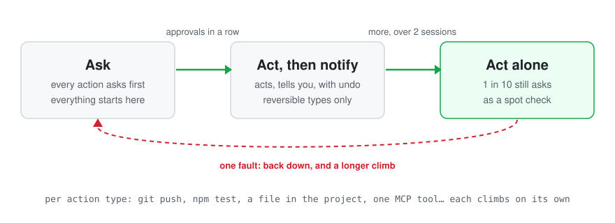

<h1 align="center">tenure</h1>

<p align="center"><strong>Hermes trusts your agent blindly. Tenure makes that trust revocable.</strong></p>

<p align="center">
  A plugin for <a href="https://github.com/NousResearch/hermes-agent">Hermes Agent</a>. No extra question for everyday
  work: files, memory, build, test, git. What it writes can be undone, anything can be flagged. The first mistake on a kind of action puts that kind, and only that
  kind, on probation: it asks first, and earns its autonomy back on verified evidence.
</p>

<p align="center">
  
  
  
  
  <a href="https://osf.io/vycge/"></a>
</p>

<p align="center">
  <a href="#install-in-60-seconds">Install</a> ·
  <a href="#how-it-works">How it works</a> ·
  <a href="#the-study-behind-the-rule">The study</a> ·
  <a href="#the-guarantee">The guarantee</a> ·
  <a href="#self-protection">Self-protection</a> ·
  <a href="#commands">Commands</a>
</p>

<p align="center"><br><sub>Illustration of the rule, not a screenshot.</sub></p>

## The problem

Out of the box, Hermes asks about a short list of risky-looking commands and lets everything else through: it
writes your files, runs your tests, edits its memory, without a word, and it keeps doing so after it gets something
wrong. There is no undo, no record, and no way to say "trust it on this, not on that". `--yolo` removes even the
short list.

Tenure keeps Hermes' speed and adds what is missing:

| Tier | What happens |
|---|---|
| **Trusted** (the start) | For files, memory, subagents and the usual local dev tools (npm, python, pytest, cargo, go, make, git...), the agent works as with Hermes alone: no extra question. Files it changes are saved first and can be undone for 24 hours (`/tenure undo`); anything can be flagged (`/tenure flag`). Trust is given, not earned: it reaches no tier and claims no guarantee. |
| **T1 · Probation** (asks first) | After its first mistake (an undo, a flag, a failed automatic check, a refusal), that kind of action asks you first. Only that kind. |
| **T2 · Under review** (acts, then tells you) | Earned back on approvals: the agent acts, then tells you, with an undo. Only for reversible types at low or medium stakes. |
| **T3 · Tenured** (acts on its own) | Earned on a series of verified successes over two sessions, under a risk you set. One in ten is still spot-checked. |

What tenure asks that Hermes alone would not:

- what leaves your machine: pushes, publishing, deploys, registry logins, messages, uploads, cloud writes, payments;
- what cannot be undone: deleting files, discarding uncommitted git work, `sed -i`, `cp`, `mv`, anything under `sudo`;
- programs outside the list above (database and unknown CLIs, or a package runner starting one), until they earn it;
- shell it cannot read safely (`for`, `if`, `python -c`), and the agent's own skills, plugins and secrets;
- every command, for the rest of a session that just read outside content (web, mail, downloads, `git pull`);
  file writes keep going with their undo, and `/new` starts afresh;
- writing through the shell (`echo … > file`, `tee`; a covered tool's own output, `pytest > log`, is fine), local
  scripts (`./run.sh`, `bash x.sh`) and `docker`. For inline code (`python -c`, `for`, `if`), "Allow for this
  session" stops the questions until the session ends.

Prefer the preregistered study's start, where every type begins on probation? `hermes tenure start probation`.

| | Hermes by default | `--yolo` | An allowlist | **tenure** |
|---|---|---|---|---|
| Extra questions on day one | - | - | - | **none for files, memory and known dev tools**; what leaves the machine, deletions and unknown CLIs ask |
| Undo of the files the agent writes | no | no | no | **yes, 24 hours** |
| Trust taken back after a mistake | no | no | by hand | **automatically, per action type** |
| Trust earned back on evidence | no | no | by hand | **yes, under a risk you choose** |
| Evidence someone else can check | no | no | no | **signed passport** |

## Install in 60 seconds

```bash
hermes plugins install otsoa-dubief/tenure/tenure
hermes gateway restart          # if a gateway is running
hermes tenure setup          # the three presets side by side
```

Requires Hermes 0.23.0 or later and Python 3.11 or later. No network, no LLM call, nothing to configure to start.
Work as usual: `hermes tenure` shows where each action type stands.

## Three pillars

**1. Your own benchmark.** Public leaderboards say how a model does on someone else's tasks. tenure keeps a
table of how each model does on yours: verified successes and faults per action type, always with the
denominator (`3 faults / 140 checks`). A bundled snapshot of public scores sits beside it, and a model that
scores clearly lower on the same benchmark loses a carry-over. A model with no public measure is shown as such.

**2. The live map.** The dashboard tab shows every agent and every action type: its tier, its evidence, what it
still needs, and what changes if you switch model or move the risk dial. Each change comes with its reason.

**3. The autonomy passport.** One file that states what an agent earned and on what evidence. It is signed and
tamper-evident: anyone holding the passport and the exported ledger can replay the ledger and recompute the
same tiers (`hermes tenure verify`). The format is in [docs/protocol.md](docs/protocol.md).

**Native in Hermes Desktop too.** The package also ships a desktop half: a **Tenure** page in the sidebar (agents,
your benchmark, passport), a status-bar chip with the tiers of the model in use, and ⌘K commands to open the map, show the
current model's passport or revoke it. Like every desktop half, it is opt-in: enable it once in
**Capabilities → Plugins**.

**Made to be looked at.** Tenure speaks Hermes' visual language: one colour (your accent), condensed titles, and
1-bit dithered progress bars that densify into a solid fill as an action type nears tenure. Each agent carries an
original dithered emblem whose density is the share of autonomy it has earned, and its passport is an animated
card: the emblem develops, the ledger head settles and a seal prints only when the signature verifies. Moments
play on real transitions only: "Tenure granted" when a type reaches T3, "Back on probation" after a fault, with the
way back. Reduced motion is honoured, and one switch turns animations off. `hermes tenure card` gives the same
record as a short text card to paste anywhere.

**In your language.** Every surface (desktop page, dashboard tab, chat messages, `hermes tenure` output) speaks
English, French, Spanish, Simplified Chinese and Arabic (right to left), and follows Hermes' own language setting
(`display.language`). The words are Hermes' own in each language; commands, tier codes and model ids stay as typed.
Catalogs and glossaries live in [`tenure/locales/`](tenure/locales).

## The study behind the rule

After a type's first mistake (or from the start with `start: probation`), tenure applies
the same rule as a preregistered study, replayed on 6,000+ simulated agents (results pending; see [docs/the-study.md](docs/the-study.md)).
It does not claim the study has confirmed the rule: the results are pending. On top of the study's rule, tenure adds
spot checks, two distinct sessions in the series that reaches T3, and suspension after external content; it adapts
the proof (a person's approval plus a clean run). Carry-over is our addition; strict mode is the study. The trusted
start is not the study either: trusted actions earn nothing and carry no guarantee. Details, the preregistration
(OSF) and every difference: [docs/the-study.md](docs/the-study.md).

## How it works

**Agents.** Each action type of each agent (`model@provider`) is trusted, or in one of the three tiers above.

**Trusted start.** A type nobody has caught in a mistake runs as with Hermes alone. Reversible actions (files in the
project) act, then tell you, with an undo; the others just run. What ends the trust: an undo, a flag
(`/tenure flag TYPE`), a file it wrote that no longer parses (Python, JSON, TOML), or your refusal when Hermes itself
asks about the call (a risky-looking command). A command that merely fails is not held against it: a failing test is
often the point. The first fault ends the trust for that type for good, in this profile, for every model, present
or future: from then on the study rule below applies, starting from T1. Trusted actions carry no guarantee: the
numbers of [The guarantee](#the-guarantee) apply to tiers earned on evidence, and a type that earns T3 while
trusted gets its spot checks like any other.

**Proofs.** A type climbs on verified outcomes, judged after the tool has run: an approved action that ran
cleanly and whose automatic check passed (the written file still parses, the exit code is zero) is a success, and
so is an act-then-notify action whose check passed (you can still undo it: an undo is a fault). A refusal, an
undo or an error you flag is a fault, and a failed check is a fault at any tier. What nobody verified (timeout,
failed tool, no one answering, a clean action taken alone) counts for nothing. A fault resets the series. A
low-stakes fault at act-alone drops one tier (to act-then-notify if the type is reversible). A medium or high
fault sends the type back to asking, lengthens the next climb, and opens a trial of 3 verified successes.
Asked-but-never-run actions are never counted as successes.

**Two sessions.** The series that reaches "act alone" must hold successes from at least two distinct sessions.

**Suspension after external content.** A session asks for everything until it ends (under the trusted start: everything but file writes, which keep
their undo; `/new` starts a fresh session), after using one of these
tools or commands: web search and extraction, the browser, `read_file` outside the project, `execute_code`,
downloads and network commands in the terminal (`curl`, `wget`, `git clone`, `git pull`, `git fetch`, `gh` reads...),
and the read tools of MCP servers that bring in outside content (mail, chat, web, search, GitHub, Notion...). The
exact list, and what is not detected, is in [docs/self-protection.md](docs/self-protection.md#suspension-after-external-content).

**Model change.** A new model inherits half its evidence provisionally (confirmed by its own
successes), except at high stakes or when it scores more than 5 points lower on the matching public benchmark. Strict mode (`hermes tenure strict on`) starts every type
over instead. A returning model keeps its own record.

**Bots and copied profiles.** Every Hermes profile, so every Bot of Bot Mode, keeps its own record: a Bot earns
autonomy for itself. A Bot's messages to its teammates (`message_agent`) are a medium-stakes type it can earn, like
delegating to a subagent; a message to a person (`send_message`) stays high stakes. A profile copied from another one (`hermes profile create --clone-all`, the desktop's
**Duplicate**) has another SOUL, other skills and other tools, so it does not inherit earned autonomy silently:
at its first start every type restarts as after a model change (half the series, provisional; strict mode: from
zero), the original's undo snapshots are dropped, and the copy signs its passports with a key of its own. The
ledger records it (`copy` event), so a passport replay recomputes the same tiers. A profile that only moved (a
restored backup, a renamed folder) keeps everything.

## The guarantee

You pick the risk you accept per stakes level. tenure turns it into a number of verified successes in a row with
the study's formula (Dodge's continuous sampling plan CSP-1, with one spot check in ten); the exact guarantee that
number gives is in the table, and can sit slightly above the risk you picked (2.1% for a 1-in-50 risk). The
table is generated from the same code that decides (`params.describe`), and a test checks it.

Cell: verified successes in a row (the first ones approved by you, the rest acted on at T2 while you could undo
them), guarantee (errors that run unapproved, as a share of all actions of the type, for a
stable agent), worst case (for an agent that turns bad after tenure, until a caught error revokes it).

| Preset | Low stakes (files in the project, memory) | Medium (commands, code, files elsewhere) | High (leaves the machine, money) |
|---|---|---|---|
| careful | 105 in a row · 1.0% · worst 7.8% | 210 in a row · 0.5% · worst 4.1% | 1052 in a row · 0.1% · worst 0.8% |
| **balanced** (default) | 52 in a row · 2.1% · worst 14.5% | 105 in a row · 1.0% · worst 7.8% | always asks |
| fast | 21 in a row · 5.0% · worst 29.0% | 52 in a row · 2.1% · worst 14.5% | always asks |

Errors you catch never run: a refused action is blocked. `hermes tenure explain` prints the numbers for your own
settings.

## Self-protection

An agent that can switch off its own supervision is not supervised. Whatever its tier, these always ask, and no
type override lowers them (`self:*`, `secrets:*`, `file:sensitive`):

- **Hermes and tenure themselves.** Hermes' CLI (except a few reads, such as `hermes status`), every file and
  folder Hermes reads from its home and that changes what it does, the Hermes program and its installed package,
  and tenure's own data. The check is made on the path once normalised and resolved (links, `..`, globs,
  braces, a glued option value), whatever program, tool or piece of code names it, and Hermes' CLI is recognised
  behind any launcher.
- **Code that would run later without asking.** Shell start-up files, git hooks and git configuration that runs a
  program, `PATH` and loader variables, editor and pager settings outside an allow list, `~/.local/bin`, login
  agents. Recognised command by command, best effort.

What can still get through is written down, family by family: a path that only exists once the code runs, a tree
walk that follows links, your own home folder as a whole, and a few others. This is a strong check on honest
mistakes and on plain attempts, not a wall against an agent that hides what it does: **if the agent is not
trusted, run Hermes in a container**, with only the project mounted, and keep code-running types at `cap`.

The full rules, every protected entry and every known gap: [docs/self-protection.md](docs/self-protection.md).

## Commands

| Command | What it does |
|---|---|
| `hermes tenure` · `hermes tenure status [--profile P] [--model M] [--all]` · `/tenure` | What each agent has earned, per action type |
| `hermes tenure setup [careful\|balanced\|fast]` | The presets side by side; with a name, use it |
| `hermes tenure explain` | How it decides, and the guarantee for your settings |
| `hermes tenure models [--type T]` | Each model's verified record on your own work |
| `hermes tenure undo [ID]` | Restore the files of an act-then-notify action; without an ID, list what can still be undone |
| `hermes tenure flag TYPE [note]` | Report an error the agent made on its own: revokes that type |
| `hermes tenure revoke TYPE\|all [--model M\|--all]` | Take earned autonomy back: one type or every type, for the last active agent, one model, or every agent |
| `hermes tenure passport [--agent A] [--out FILE] [--no-redact]` | Write the signed passport of an agent |
| `hermes tenure card [--model M] [--no-redact]` | The passport as a short text card, one bar per action type, to paste in a chat or a post (names of your scripts hashed, as in the passport) |
| `hermes tenure verify PASSPORT [LEDGER] [--key HEX]` | Check a passport, against the exported ledger when given; `--key` pins the owner's public key |
| `hermes tenure anchor` | One line to publish: the ledger's head, date and length |
| `hermes tenure export [PATH]` | Write the evidence ledger as hash-chained JSON lines |
| `hermes tenure start trusted\|probation` | Trusted start (default: no question before a type's first mistake) or the study's start (every type on probation) |
| `hermes tenure strict on\|off` | Strict mode: a new model starts with an empty record |
| `hermes tenure cleanup` | List dead tenure keys in Hermes' permanent allowlist (prints, never edits) |

Settings, in `config.yaml` under `plugins.entries.tenure.settings`:

```yaml
preset: balanced            # careful | balanced | fast
risks: {low: 1/50, medium: 1%, high: cap}   # your own, over the preset
spot_check: 0.1             # share of a cleared type's actions that still ask
start: trusted              # trusted | probation (the study's start: every type asks until it earns autonomy)
strict: false
types: {"mcp:notion:*": medium, "shell:git:push": cap}   # reclassify action types
enabled: true
```

## Limits

- **A copied profile is caught only inside one install, and only once the original has run this version.** The
  check compares the database file with the other profiles of the same Hermes root. A copy made before the
  original ever ran tenure 1.0.0 or later, a copy whose original was deleted before the copy first started,
  or a copy placed outside the install (another `HERMES_HOME`, another machine) keeps the original's record. Until
  a copy starts, the dashboard shows it at T1 with "copied from another profile" and signs no passport for it.
- **It over-asks by design.** Shell constructs outside the supported grammar (`if`, `for`, functions, globs in a
  write target), write targets it cannot resolve, and any name that looks sensitive are classified as high stakes
  or always-ask. Most wrong guesses cost you a question.
- **Static reading, not a sandbox.** tenure classifies the text of a command before it runs. A spelling it does
  not recognise can slip through: a tool's own setting variable it does not watch (`GH_PAGER`,
  `RIPGREP_CONFIG_PATH`, `KUBECONFIG`...), a shell alias, function or `trap` set in an earlier call, or a form of a
  command nobody has thought of yet. Each one found so far is capped in the tests (`tests/test_audit_cap_bypass.py`).
  If the agent itself is untrusted, run Hermes in a container as well.
- **Granularity is per action type.** A cleared `shell:python` can run any Python. Reclassify broad types as `cap`
  if that matters to you.
- **Memory is low stakes.** Hermes' `memory` tool is classed with project files (low stakes), so it can be cleared;
  writing the files under `memories/` directly is capped. Reclassify `memory:write` if memories steer your agent.
- **The passport is tamper-evident; it cannot prevent tampering.** It is signed by the owner's own key, so the owner can
  rewrite a whole history and re-sign it. Anchor its head (`hermes tenure anchor`) somewhere public to fix a point in time.
  The signature shows that a passport matches a ledger, not who made it: pin the owner's key with `verify --key`.
  An older passport still verifies against a longer ledger; `verify` then says what changed since.
- **The database trusts itself.** tenure reads its tiers from its own database, and the hash chain is not a
  secret. Code that is already allowed to run (see the limit under Self-protection) could rewrite both; writing
  them by any command tenure can read is capped.
- **Redaction uses unsalted hashes.** A redacted passport hides a type name from a casual reader, not from
  someone who guesses it.
- **SQLite side files.** The dashboard opens each database read-only; on a database in WAL mode SQLite may still
  create or touch the `-wal` and `-shm` files next to it. No table or row is written by a read.
- **Settings from the dashboard** (`/settings`) may not reach the plugin from the dashboard process; the tab then
  shows the CLI command to run.
- **Learning needs a person to answer.** `approvals.mode` `smart` (the Hermes default) and `manual` both work:
  tenure's own approvals skip the smart guardian and always reach you. With `--yolo`, `off` or cron, Hermes
  settles the ask itself and nothing is learned; a verdict given by the smart guardian on Hermes' own prompts
  counts for nothing.
- **Git hooks.** `git config core.hooksPath .husky` (the husky set-up) is capped: it always asks.
  Turning a pager on or off (`pager.log false`) is ordinary.
- Only a person teaches: approvals count when a person answers, and a T2 action counts only when someone could
  undo it (under cron or `--yolo` it still acts and keeps its undo, but counts for nothing). Records are per model and per Hermes profile.
- The guarantee covers errors you would refuse when asked. An error nobody would notice cannot be counted.

## Privacy

Stored, in `plugin-data/tenure/tenure.db` of each Hermes profile: action types and stakes, outcomes, tiers,
the agent string `model@provider`, sessions as `sha256(session id)[:12]`, timestamps, and a hash chain over all of
it. 
Never in the database or the ledger: a whole command, a path, file content, a message, or a secret. Type names can
include a script, target or alias name taken from the command (`shell:npm:run:build`, `shell:make:deploy`,
`shell:git:my-alias`): the ledger keeps them, and the passport and the dashboard redact them by default (a hash of
the name, see [docs/protocol.md](docs/protocol.md) §3.1). The undo snapshots (file bytes and their paths, mode
0600) are the one other exception, deleted after 24 h. The database also holds the undo HMAC key, a random
secret that signs each snapshot so that a changed snapshot is never restored. Nothing leaves your machine:
no network access, no LLM call, no telemetry. tenure does not read `.env`, `auth.json` or any credential
store. Reads outside the plugin folder, as the catalog asks: the dashboard tab reads, read-only, the
`plugin-data/tenure/tenure.db` of the Hermes root and of each `profiles/*` folder; act-then-notify reads the
project files an action is about to change, to snapshot them for undo (24 hours, 5 MB per action).

## License

Apache-2.0 · © 2026 Otsoa Dubief. Benchmark data: Epoch AI, CC BY 4.0, see [NOTICE](tenure/NOTICE).
