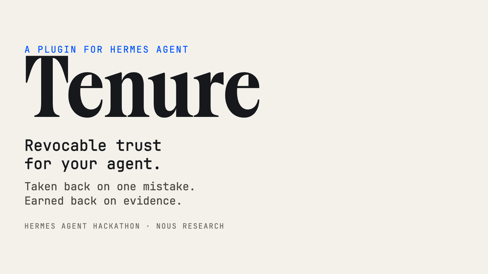
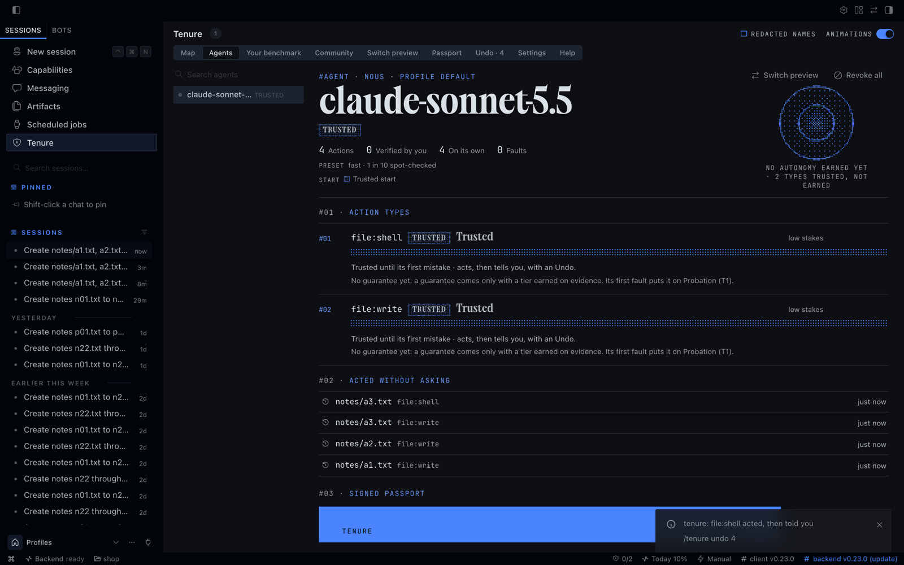
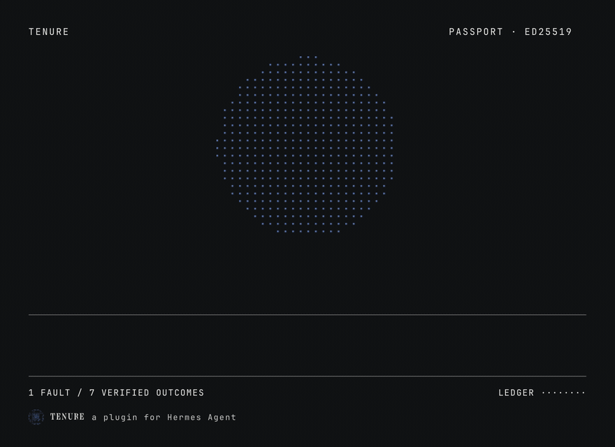

# tenure



**Revocable trust for your Hermes agent: given by default, taken back on a mistake, earned back on evidence.**

No extra question for everyday work: files, memory, build, test, git. What the agent writes can be undone, anything
can be flagged. The first mistake on a kind of action puts that kind, and only that kind, on probation: it asks
first, and earns its autonomy back on verified evidence, following a rule preregistered on OSF.

- **Trusted at the start**: files, memory, subagents and the usual dev tools (npm, python, pytest, cargo, git...)
  work as with Hermes alone. Files it changes are saved first and can be undone for 24 hours (`/tenure undo`).
- **One mistake, one kind**: an undo, a flag, a failed check or a refusal puts that kind on probation (T1, asks
  first); approvals earn back T2 (acts, then tells you), verified successes over two sessions T3 (acts on its own,
  one in ten spot-checked).
- **Always asks** what leaves the machine (push, publish, deploy, uploads, payments) and what cannot be undone;
  after the agent reads outside content (web, mail, downloads), commands ask for the rest of the session.
- **Field categories**: an MCP call that touches a secret or a bank field (IBAN, password, token...), or a field it
  cannot read (custom field ids, free SQL, generic REST writes), earns trust apart from its tool and always asks
  under the default preset. Other categories ship off; `fields:` turns them on.
- **Signed autonomy passport**, hash-chained and replayable (`hermes tenure verify`), a per-model benchmark of
  your own work, a switch preview before changing model, a Desktop page and a dashboard tab, five languages.
- **Local**: no network call, no LLM call. Linux, macOS and Windows (on Windows, plain shell file commands ask
  instead of acting with an undo).



*A real Hermes Desktop session, not a mockup.*

## Install

```bash
hermes plugins install tenure
hermes gateway restart        # if a gateway is running
hermes tenure setup           # the three presets side by side
```

In Hermes Desktop, turn the page on once: **Capabilities → Plugins → Tenure**.



Full documentation, the study behind the rule and the known limits:
[github.com/otsoa-dubief/tenure](https://github.com/otsoa-dubief/tenure#readme).
