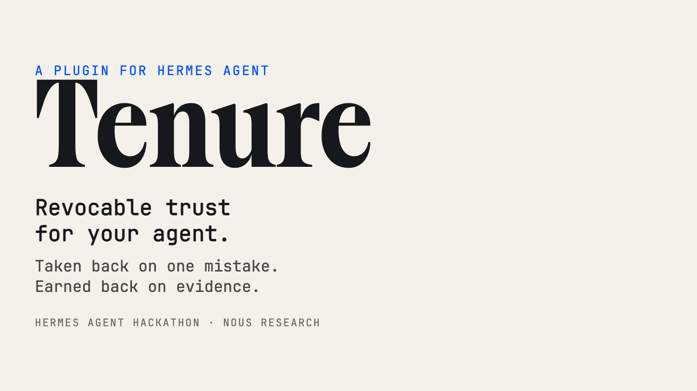
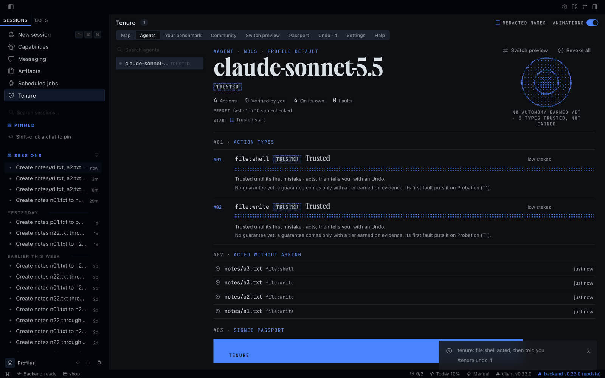
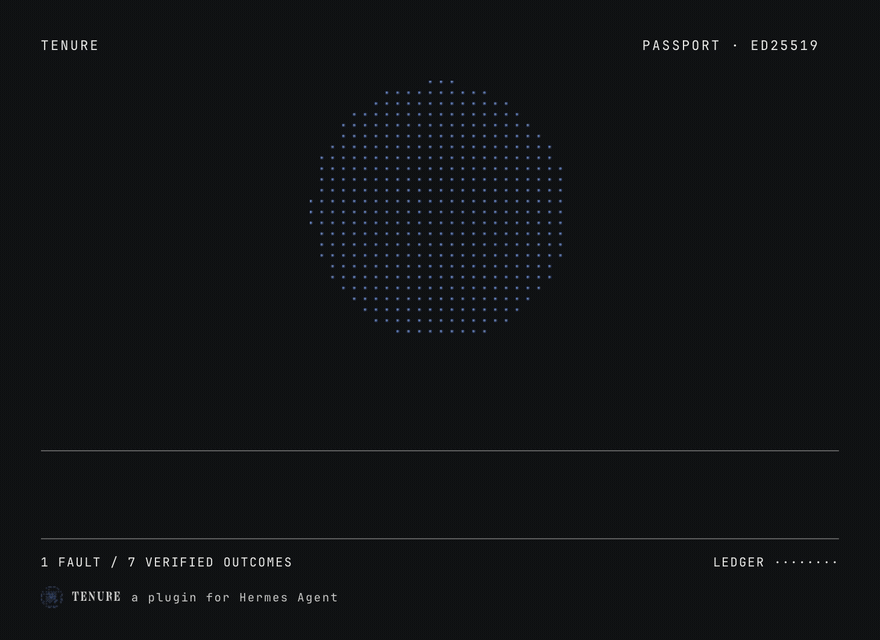

# Tenure

**Your Hermes agent works without asking. When it gets a change wrong, you undo it, and from then on that kind of
action is listed for you after each turn, with an undo.**

- **It runs without asking**: file edits, memory, subagents, the usual dev tools (npm, pytest, cargo, go, make,
  git...), and plain `rm`, `mv`, `cp`, `sed -i` or `echo > file` on project files. Reads never ask.
- **File changes are saved first**: edits through Hermes' file tools and plain file commands on project files (`rm`,
  `mv`, `cp`, `sed -i`, `touch`, `> file`, alone or chained) are saved before they run: `/tenure undo N` puts them back
  for 24 hours. Everything else runs as with Hermes alone and can't be undone: a test run, a build, a commit, files
  changed by another program (a formatter, a script). An undo puts the files back exactly as they were before that
  change: later edits to the same files are overwritten.
- **One mistake, one kind**: an undo, a refusal, a flag or a file that no longer parses makes that kind of action
  watched: it keeps working, and the turn ends with one line listing those actions and `/tenure undo`. A kind Tenure
  can't undo asks first instead. A second mistake, and it asks first. A run of actions you keep frees it again (52 in
  a row for a low-risk kind with the default preset); `/tenure trust KIND` frees it now, on your word.
- **Some things ask you**: pushes, publishing, deploys, uploads, messages to people, payments and new packages always
  ask; programs whose changes Tenure can't save (docker, database CLIs, unknown tools, MCP tools that write) ask until
  you free them. After the agent reads outside content (web, mail, downloads), its next command asks once, and your
  yes lets the conversation work as before.
- **Three commands**: `/tenure` (what the agent did today, what you can undo), `/tenure undo N`, `/tenure trust`
  (what still asks you, and why); every other command under `/tenure advanced`.
- **See what you approve, flag one action**: a prompt shows the target of a call first and whole, secret values as
  `•••` (the keys it recognises, no guarantee); an action that ran under Tenure's watch has a number for 24 hours
  (`/tenure flag`, `/tenure flag 12`).
- **Field categories**: an MCP call that touches a secret or a bank field (IBAN, password, token...), or a field it
  cannot read (custom field ids, free SQL, generic REST writes), is a kind of its own and always asks under the
  default preset. Other categories ship off; `fields:` turns them on.
- **Study mode** (opt-in, `hermes tenure mode study`): the rule of a study preregistered on OSF, with tiers earned on
  verified evidence, random spot checks, a guarantee you choose and a signed, hash-chained, replayable autonomy
  passport (`hermes tenure verify`).
- **Also**: a per-model benchmark of your own work, a Desktop page and a dashboard tab (what ran, what you can undo,
  what still asks and why), five languages; in study mode, a switch preview before changing model.
- **Local**: no network call, no LLM call. Linux, macOS and Windows (on Windows, plain shell file commands ask
  instead of running with an undo).

## Install

```bash
hermes plugins install otsoa-dubief/tenure/tenure
hermes gateway restart        # if a gateway is running
```

In Hermes Desktop, enable Tenure's page once: **Capabilities → Plugins → Tenure**.

## Study mode, in pictures (1.3)

These come from 1.3, when study mode was the default: they show its tiers and its passport.





*A real Hermes Desktop session with 1.3, in study mode, not a mockup.*



Full documentation, the study behind the rule and the known limits:
[github.com/otsoa-dubief/tenure](https://github.com/otsoa-dubief/tenure#readme).
